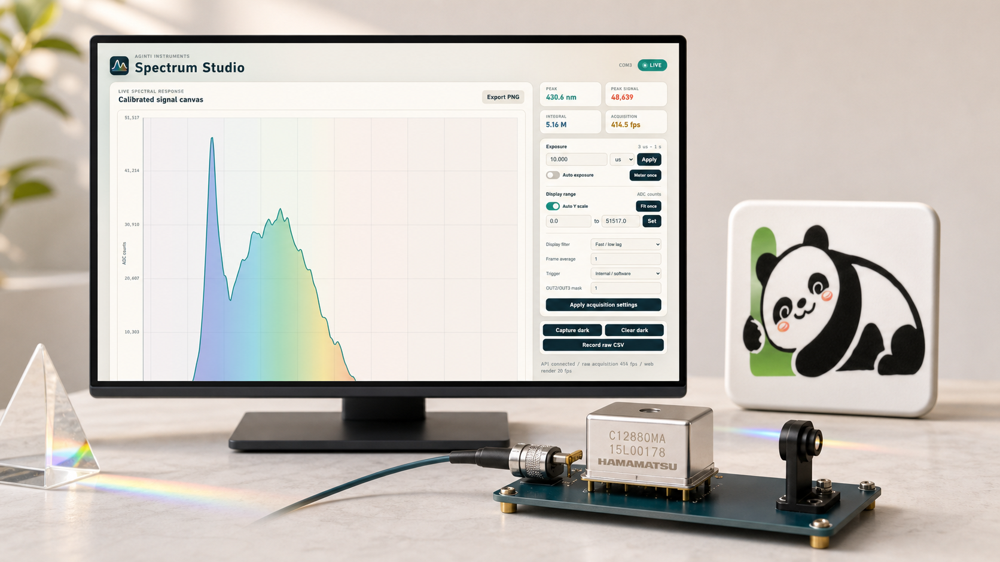

# AgInTi Spectrometer

[English](../README.md) · [العربية](README.ar.md) · [Español](README.es.md) · [Français](README.fr.md) · [日本語](README.ja.md) · [한국어](README.ko.md) · [Tiếng Việt](README.vi.md) · [中文 (简体)](README.zh-Hans.md) · [中文（繁體）](README.zh-Hant.md) · [Deutsch](README.de.md) · [Русский](README.ru.md)

[](https://lazying.art)



AgInTi Spectrometer — высокоскоростная среда сбора и визуализации данных C12880MA. Единое ядро обслуживает Qt-приложение, веб-панель, запись CSV, CLI и REST API. Последовательный сбор отделён от отрисовки для сохранения временного разрешения.

## Возможности

- Калиброванный спектр 340–850 нм.
- Фиксированная, адаптивная и разовая оценка экспозиции от микросекунд.
- Независимые частоты сбора и обновления экрана.
- Вычитание тёмного кадра, усреднение, фильтры, автомасштаб и сырой CSV.
- Настольный интерфейс, веб-интерфейс и API для агентов.

## Быстрый запуск

```powershell
python -m venv .venv
.\.venv\Scripts\python.exe -m pip install -e .
.\.venv\Scripts\spectrum-studio.exe
```

Подключите прибор, выберите COM-порт и запустите сбор. Фильтры отображения не изменяют записанные исходные данные.

## Поддержка

<!-- support:start -->
[](https://github.com/sponsors/lachlanchen)
[](https://chat.lazying.art/donate)
[](https://paypal.me/RongzhouChen)
[](https://buy.stripe.com/aFadR8gIaflgfQV6T4fw400)
<!-- support:end -->
